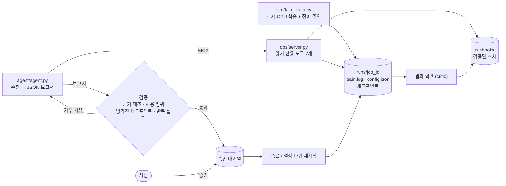

# Experiment Ops Agent

GPU 학습 job의 장애를 감지하고 원인을 진단한 뒤, **사람의 승인을 받아** 설정을 고쳐 재시작하는 LLM Agent.
실제 GPU에서 장애를 주입해 평가하고, 규칙 기반 감시 스크립트와 비교했다.

> **30초 요약**
> - **문제**: 연구 중 학습 job이 hang·OOM·NaN으로 멈추면 사람이 로그를 보고 고쳐야 했다. 기존 대응은 "로그가 N초 조용하면 kill -9" 규칙 스크립트.
> - **감지**: 규칙은 threshold를 낮추면 느린 정상 job을 죽이고(false kill 3/15), 높이면 장애를 전부 놓친다(12/12). Agent는 처음 보는 조건에서 **false kill 0/15, 놓침 0/12**.
> - **수정**: 설정이 원인인 장애(lr 발산·OOM·손상 데이터)를 처음 보는 조건에서 **6/6** 올바르게 고쳤다 (그냥 재시작은 0/6).
> - **메모리**: 결과가 확인된 조치만 runbook으로 기억하자, 재시작으로는 안 풀리는 장애를 첫 시도에 푼 비율이 **0/14 → 12/14** (95% CI 밖), 비용 −39%.
> - **과정**: 실패·회귀·평가 버그 25건과 그 해결을 [문제 해결 기록](docs/troubleshooting_log.md)에 남겼다. 발표용 요약: [docs/highlights.md](docs/highlights.md)

## 왜 만들었나

박사 과정에서 Voyager 기반 실험(Minecraft agent)을 수십 개씩 큐로 돌렸다. 학습은 끝났는데 종료하다 멈추는 job이 계속 생겨서,
"로그에 `Iteration limit reached`가 있고 120초간 안 바뀌면 `kill -9`" 하는 감시 스크립트를 만들어 썼다.
이 스크립트는 아는 장애 하나만 잡고, 느린 job과 멈춘 job을 구분하지 못하고, 왜 멈췄는지·어떻게 고칠지는 말해 주지 않는다.
이 스크립트를 **베이스라인**으로 두고, 같은 문제를 Agent로 풀면 무엇이 나아지고 무엇이 위험한지 측정하는 것이 이 프로젝트의 목표다.

## 구조



**설계 원칙** — 대부분 평가에서 실패를 보고 나서 정한 것이다.

1. **Agent는 읽기만 한다.** kill·restart 도구는 물론 승인 요청 도구도 주지 않는다. 보고서에 쓴 조치를 코드가 대기열에 넣는다.
   (요청을 도구로 줬을 때 "terminate 요청함"이라 쓰고 실제로는 안 부른 경우가 있었다 — [6번](docs/troubleshooting_log.md))
2. **"하지 마라"고 부탁하지 않고 할 수 없게 만든다.** 프롬프트에 "batch를 줄이지 마라"를 써도 OOM 수정 제안 7번 중 3번은 batch를 줄였다.
   실험 의미를 바꾸는 설정은 변경 목록에서 빼고, 망가진 체크포인트로의 재시작과 반복 실패한 조치는 검증 코드가 거부한다. ([15번](docs/troubleshooting_log.md), [21번](docs/troubleshooting_log.md))
3. **제안은 근거와 대조한다.** 보고서에 인용한 오류가 그 job의 로그에 실제로 있어야 하고, 데이터 shard는 손상·멈춤 증거가 있을 때만 뺄 수 있다.
   거부할 때는 이유를 돌려줘 한 번 고쳐 쓰게 한다. ([14번](docs/troubleshooting_log.md), [16번](docs/troubleshooting_log.md))
4. **승인한 것이 그대로 실행된다.** "마지막 체크포인트부터" 같은 의도가 아니라 구체적인 step을 승인받고, 실행 직전에 다시 검증한다. ([17번](docs/troubleshooting_log.md))
5. **기억은 검증된 것만.** 실행 후 결과가 확인된 조치만 runbook이 된다(Voyager skill library와 같은 원리). 실패한 조치도 기록한다.
6. **종료는 SIGTERM 먼저**(체크포인트 저장 기회), 응답이 없을 때만 SIGKILL. pid 재사용·좀비를 구분해 엉뚱한 프로세스를 죽이지 않는다.

## 결과

모든 평가는 `sim/fake_train.py`가 2080 Ti에서 실제로 학습하면서 장애를 일으키는 job으로 한다. job id는 랜덤이고 정답은 평가 스크립트만 안다.
Agent는 보고서가 아니라 **실제로 실행된 행동과 그 결과**로 채점한다. 모델은 gpt-5-mini.
**dev**는 개발 중 보고 고친 시나리오, **held-out**은 한 번도 돌려 보지 않았고 결과를 보고 고치지 않은 시나리오다.

### 1. 감지: 장애 job을 멈추게 했나, 정상 job을 건드렸나

| 방법 | dev: false kill / 놓침 | held-out: false kill / 놓침 | 비용/순찰 |
|---|---|---|---|
| **Agent** | **0/15 / 0/9** (진단 24/24) | **0/15 / 0/12** (진단 25/27) | $0.011~0.017 |
| 규칙: 로그가 10~30초 조용하면 hang | 0/15 / 3/9 | **3/15** / 3/12 | $0 |
| 규칙: 60초 | 0/15 / 9/9 | 0/15 / **12/12** | $0 |
| 규칙: 그 job의 평소 로그 간격 ×5, ×10 | 0/15 / 3/9 | 3/15 / 3/12 | $0 |

규칙이 놓친 3개는 전부 loss가 NaN인 job이다(로그는 계속 찍히므로). 마지막 줄은 Agent에게 준 것과 같은 신호를 규칙에도 줘 본 것으로, 신호가 아니라 판단 방식의 차이임을 확인하기 위한 비교다.
※ 감지 평가는 재시작 정책(2단계)을 넣기 전의 시스템으로 쟀다.

### 2. 수정: 다시 돌린 job이 끝까지 정상 완료됐고, 실험의 의미는 그대로인가

| 방법 | held-out 좋은 수정 | 설정이 원인인 장애 (lr 발산·OOM·손상 shard) | 정상 job 건드림 |
|---|---|---|---|
| **Agent** | **8/10** | **6/6** | 0/4 |
| 그냥 재시작 (설정 그대로, 마지막 체크포인트부터) | 2/10 | 0/6 | 0/4 |

- "좋은 수정" = 끝까지 완료 **그리고** 의미 보존(실질 batch 유지, 원인 설정만 변경, 발산 **전** 체크포인트). batch를 1000분의 1로 줄인 수정은 job은 끝까지 돌지만 실험이 바뀐 것이라 실패로 친다.
- 제안은 사람이 **검토 없이 전부 승인**했다고 가정했다(제안 품질 그 자체를 보기 위해).
- Agent가 틀린 2개는 "살아 있는데 오래 조용한 job"을 정상으로 본 것. 근거에는 13배 침묵을 적어 놓고 결론은 정상이었다. ([19번](docs/troubleshooting_log.md))
- dev에서는 4번 고쳐서 6/8 → 7/8이 됐다. 고칠 때마다 다른 곳이 망가졌고, 결국 규칙을 코드로 옮기는 것으로 정리됐다. ([13~16번](docs/troubleshooting_log.md))

### 3. 메모리: 검증된 조치를 기억하면 다음 장애를 더 빨리 푸나

memory off/on × seed 2개 × 8 에피소드. 같은 seed·에피소드면 두 조건이 같은 장애를 본다(짝 비교). 에피소드마다 최대 3라운드(순찰 → 승인 → 결과 확인).

| | 재시작해도 같은 shard에서 또 멈추는 job: 첫 라운드 해결 (ep2 이후) | 평균 라운드 | OOM 첫 라운드 해결 | 에피소드당 비용 |
|---|---|---|---|---|
| memory off | 0/14 | 2.44 | 16/16 | $0.037 |
| **memory on** | **12/14** | **1.38** | 16/16 | **$0.023** |

- 짝 16개 평균 차이 **+1.06라운드, 95% CI [+0.62, +1.44]**. memory on은 ep4부터 모든 장애를 첫 라운드에 해결했다.
- memory off는 매번 "처음 멈춘 job은 같은 설정으로 재시작"이라는 합리적인 기본값을 따르다 한 라운드를 버렸다. memory on은 앞 에피소드의 "같은 설정 재시작은 실패, 멈춘 shard 제외는 성공"을 **다른 shard 번호**에 적용했다. runbook은 숫자가 아니라 관계를 저장한다.
- **한계**: 효과는 경험 없이는 첫 시도에 맞히기 어려운 장애 1종에서만 났다. 로그만으로 고칠 수 있는 OOM은 차이 0이다. 그 장애 유형은 직접 설계했다.
- 처음 3 에피소드 결과(6/6 vs 3/6)는 결과 판정(critic)이 "느려진 재시작"을 "다시 멈춤"으로 오판한 버그 때문이었다. 고친 뒤 3 에피소드로는 우연과 구분되지 않았고, 16쌍에서 구간이 0을 벗어났다. ([20~24번](docs/troubleshooting_log.md))

## 문제 해결 기록에서 고른 것

전체 25건: [docs/troubleshooting_log.md](docs/troubleshooting_log.md)

| # | 일어난 일 | 원인 | 해결 |
|---|---|---|---|
| 4→5 | NaN을 놓쳐서 고쳤더니 이번엔 hang을 놓침 | 요약 도구에 loss가 없었고, 넣자 멈추기 직전 줄의 정상 loss를 믿음 | "평소 로그 간격 대비 몇 배 조용한가"를 요약에 추가 → 둘 다 해결, 비용 −46% |
| 13 | 발산한 job을 lr은 맞게 낮췄는데 망가진 체크포인트에서 재시작 | 체크포인트 도구가 "업데이트 전 loss"를 보여 줘 오해를 부름 | Agent가 아니라 도구를 고침: 그 가중치에서 나온 다음 loss를 보여 줌 |
| 15 | 프롬프트로 "batch 줄이지 마라"를 반복해도 계속 줄임 | 확률적 행동은 프롬프트로 확률만 낮아짐 | 변경 가능 설정에서 batch를 제거 (코드로 강제) |
| 17 | 평가 도중 승인 실행에서 프로그램이 죽음 | 승인을 기다리는 동안 "마지막 체크포인트"가 망가진 것으로 바뀜 | 승인 대상을 구체적인 step으로 고정, 실행 직전 재검증 |
| 20 | memory ablation 1차의 좋은 숫자가 가짜였음 | critic이 느려진 재시작을 실패로 기록 | 저장된 runbook을 열어 보고 발견. 멈춤 판정을 "지금 구간의 예상 간격" 기준으로 |
| 23 | 큰 평가가 서버 디스크 100GB를 채움 | 체크포인트 보관 정책 없음 | 최근 5개 + 이정표만 보관, 평가 후 삭제 |

## 한계와 다음에 할 것

- **시뮬레이터 평가다.** 장애 유형·로그 형식을 직접 설계했다. 실제 연구 로그를 재생하는 평가가 필요하다.
- **남은 실패 유형**: 살아 있는데 오래 조용한 job을 정상으로 보고. 코드로 일관성 검사를 넣고 새 held-out으로 재야 한다.
- 모델 1개(gpt-5-mini), 평가 반복 수 2~3회(메모리는 16쌍).
- 디스크 사용량 감시(평가가 디스크를 채운 일 이후, 23번). 승인 대기열을 JSON 파일 대신 DB로(서버 여러 대일 때 동시 승인 방지).

## 실행

```bash
conda create -n exp-ops python=3.11 && conda activate exp-ops
pip install torch --index-url https://download.pytorch.org/whl/cu124
pip install mcp==2.3.0 openai==3.46.0 python-dotenv==1.2.4 pytest==9.2.0
cp .env.example .env        # OPENAI_API_KEY 입력
pytest                      # 54개, OpenAI API 호출 없음
```

직접 돌려 보기

```bash
python sim/fake_train.py --job-id run-a --gpu 1 --steps 3000 --stage2-at 150 --stage2-lr 1e3 &   # loss 발산
python sim/fake_train.py --job-id run-b --gpu 1 --steps 300 --bad-shards 3 &                       # 손상 shard
python agent/agent.py       # 순찰 1회: 진단 보고서 + 승인 요청 등록
python ops/approve.py       # 대기 중인 요청 보기
python ops/approve.py 1 --yes
```

승인 API (웹 화면·슬랙 버튼이 붙을 자리)

```bash
pip install -r requirements.txt
OPS_API_TOKEN=<임의의 긴 문자열> uvicorn api.app:app --port 8100
curl localhost:8100/jobs
curl -X POST localhost:8100/patrol -H "X-API-Token: $OPS_API_TOKEN"                  # 순찰 → 승인 요청 등록
curl "localhost:8100/approvals?status=pending"
curl -X POST localhost:8100/approvals/1/approve -H "X-API-Token: $OPS_API_TOKEN" \
     -H "Content-Type: application/json" -d '{"decided_by": "me"}'
```

조작 API(순찰·승인·거절)는 토큰이 있어야 한다. 학습 job을 죽일 수 있는 버튼이기 때문이다. 같은 요청이 동시에 두 번 승인되지 않게 대기열을 잠근다.

Docker (학습 job은 호스트에서 돌고, 컨테이너는 그 job을 보고 승인된 조치를 실행한다)

```bash
docker build -t exp-ops-api .
docker run -d --pid=host --user $(id -u):$(id -g) --security-opt apparmor=unconfined \
  -e OPS_API_TOKEN=... -v $(pwd)/runs:/app/runs -v $(pwd)/state:/app/state -p 8100:8100 exp-ops-api
```

- `--pid=host`: 호스트의 학습 프로세스를 보고 종료하려면 필요하다. `--user`: root가 아니라 같은 사용자로 돌려, 그 사용자의 job 말고는 종료할 수 없게 한다.
- `apparmor=unconfined`: Docker 기본 AppArmor 정책이 컨테이너 밖으로의 신호를 막아 종료가 실패했다(25번). 데모용 설정이며, 운영이라면 필요한 신호만 허용하는 전용 프로필이 맞다.
- 재시작은 학습 환경(torch, GPU)이 필요해서 이 이미지 안에서는 동작하지 않는다(이미지 220MB). 조회·진단·승인·종료까지가 컨테이너의 범위다.

평가 (실제 API 호출, 수 분~1시간, 수십 원~수백 원)

```bash
python eval/run_eval.py --set heldout --repeat 3         # 감지: Agent vs 규칙
python eval/run_fix_eval.py --set heldout --repeat 2     # 수정: Agent vs 그냥 재시작
python eval/run_memory_eval.py --episodes 8 --seed 1     # 메모리 ablation
python eval/summarize_memory.py eval/results/*_memory_s*.json
```

## 폴더

| 경로 | 내용 |
|---|---|
| `sim/fake_train.py` | 실제 GPU 학습 + 장애 주입 (설정 기반: lr 발산, OOM, 손상·멈춤 shard / 강제: hang, 종료 시 hang, 느려짐) |
| `baseline/rule_watchdog.py` | 규칙 기반 감시기 (기존 감시 스크립트를 일반화) |
| `ops/server.py` | MCP 서버: 읽기 전용 도구 7개 |
| `ops/jobs.py` | job 조회, 안전한 종료·재시작, 변경 검증 |
| `ops/approvals.py` | 승인 대기열, 실행, 결과 확인(critic) |
| `ops/runbooks.py` | 장애 서명, 검증된 조치 저장·검색 |
| `agent/agent.py` | 순찰 루프, 운영 정책, 근거 대조, 보고서 → 승인 요청 |
| `api/app.py` | 승인 API (FastAPI, 토큰 인증) |
| `Dockerfile` | 조회·진단·승인 API 이미지 |
| `eval/` | 감지·수정·메모리 평가와 통계 |
| `tests/` | 안전장치·파싱·검증·메모리 테스트 |
| `docs/troubleshooting_log.md` | 문제 해결 기록 25건 |
| `docs/highlights.md` | 발표·면접용 정리 |
